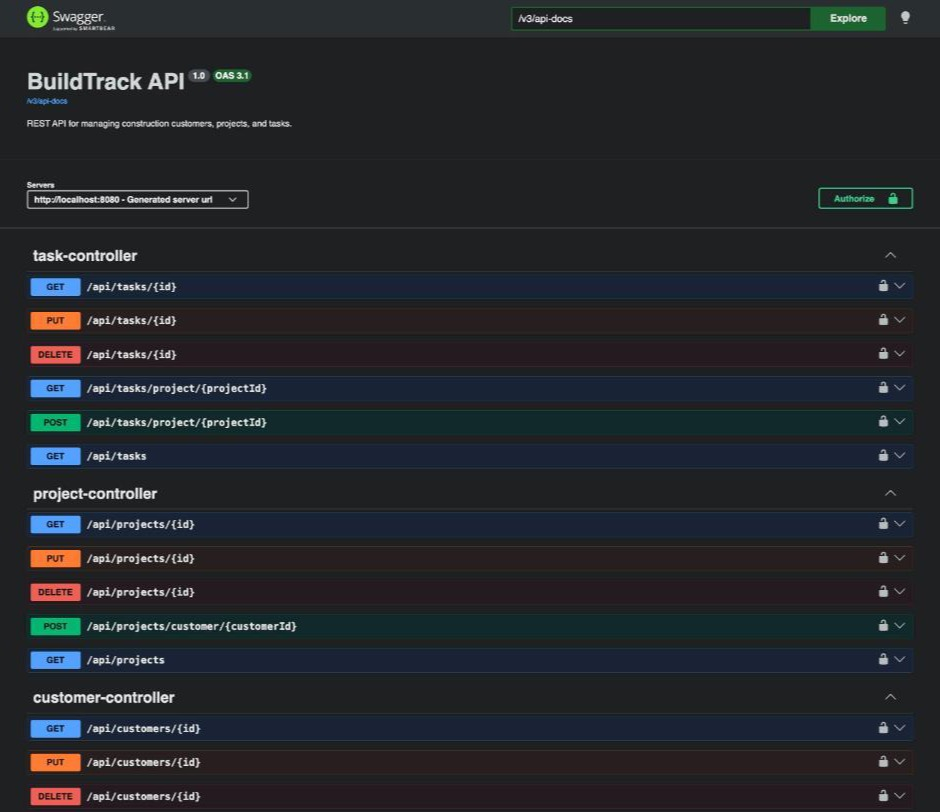

# BuildTrack

[](https://github.com/chrisjbev/buildtrack/actions/workflows/ci.yml)

BuildTrack is a REST API for managing a construction business. It keeps track of **customers**, the **projects** you build for them, and the **tasks** inside each project. Access is secured with JWT, and roles separate admins from regular users.



## Highlights

- **Stateless JWT security** with a custom authentication filter, BCrypt password hashing, and method-level role checks (`@PreAuthorize`).
- **Correct HTTP semantics:** `401` when not logged in, `403` when the role isn't allowed, `400` with field-level messages for invalid input.
- **Relational data model:** Customer → Project → Task, built with JPA/Hibernate on PostgreSQL.
- **Versioned schema migrations:** Flyway owns the database schema, and Hibernate only validates that the entities match it.
- **Layered architecture:** controllers, services, repositories, DTOs, and global exception handling.
- **62 automated tests:** unit tests, MockMvc controller tests, and integration tests against a real PostgreSQL database.
- **Continuous integration:** GitHub Actions runs the full test suite on every push.
- **Containerized:** a multi-stage Dockerfile, plus Docker Compose for the app and its database.
- **Reviewer-ready demo mode:** an optional seeder loads sample customers, projects and tasks, plus a read-only demo login.
- **Self-documenting API:** OpenAPI / Swagger UI with JWT "Authorize" support.

## Features

- **Customers:** create, view, update and delete customers, and list each customer's projects.
- **Projects:** linked to a customer, with address, start date, expected completion date and status.
- **Tasks:** linked to a project, with due date and status.
- **JWT authentication:** register and log in to receive a token that is valid for 24 hours.
- **Role-based access:**
  - Any logged-in user can read data.
  - Only `ADMIN` users can create, update or delete it.
- **Validation:** request bodies are checked, and errors come back as clear JSON messages.
- **Interactive API docs:** Swagger UI, generated with springdoc-openapi.
- **Tests:** unit, controller and security integration tests.

## Tech stack

| Area | Technology |
|---|---|
| Language | Java 21 |
| Framework | Spring Boot 4.1 (Web MVC, Data JPA, Validation, Security) |
| Database | PostgreSQL, accessed through Hibernate / JPA |
| Migrations | Flyway |
| Authentication | JWT (jjwt 0.12), BCrypt password hashing |
| API docs | springdoc-openapi 3 (Swagger UI) |
| Build | Maven (wrapper included) |
| Testing | JUnit 5, Spring Boot Test, MockMvc |

## Project structure

```
src/main/java/com/buildtrack/buildtrack
├── config/        OpenAPI / Swagger configuration
├── controller/    REST endpoints
├── dto/           Request and response objects
├── exception/     Global error handling
├── model/         JPA entities and enums
├── repository/    Spring Data repositories
├── security/      JWT filter, JWT service, security rules
└── service/       Business logic
```

## Getting started

### Prerequisites

- Java 21
- PostgreSQL running on `localhost:5432`
- Maven is optional, because the project includes `./mvnw`

### 1. Create the database

```sql
CREATE DATABASE buildtrack;
```

Flyway creates the tables on the first run. See [Database migrations](#database-migrations).

### 2. Add local settings and secrets

Create a file named `local.properties` in the project root. It is already listed in `.gitignore`, so it will not be committed.

```properties
# Your PostgreSQL password
DB_PASSWORD=your_db_password
# Base64-encoded key of at least 256 bits. Generate one with: openssl rand -base64 64
JWT_SECRET=your_base64_secret
# Optional: admin account (see step 4)
ADMIN_USERNAME=
ADMIN_PASSWORD=
# Optional: load sample data and a read-only demo login
DEMO_DATA=false
```

`DB_URL` (default `jdbc:postgresql://localhost:5432/buildtrack`) and `DB_USERNAME` (default `postgres`) can also be set here when your setup differs. Environment variables with the same names override these values.

### 3. Run the application

```bash
./mvnw spring-boot:run
```

You can also run `BuildtrackApplication` from IntelliJ IDEA.

The API starts at `http://localhost:8080`.

### 4. Create an admin user

Set both values in `local.properties` and restart the app:

```properties
ADMIN_USERNAME=admin
ADMIN_PASSWORD=choose_a_strong_password
```

On startup, the app creates that user with the `ADMIN` role. If the username already belongs to a registered user, that user is promoted to `ADMIN` and the password is left unchanged. New accounts created with `POST /api/auth/register` always get the `USER` role.

## Try it with demo data

Set `DEMO_DATA=true` in `local.properties`, or as an environment variable, and start the app. On an empty database it loads:

- **3 customers**, **4 projects** and **7 tasks**, covering every project and task status.
- A **read-only demo login**:

| Username | Password | Role |
|---|---|---|
| `demo` | `DemoPass123!` | `USER` (can read everything, cannot change data) |

To try it:

1. Open Swagger UI and run `POST /api/auth/login` with the demo credentials.
2. Copy the `token`, click **Authorize**, and paste it.
3. Try `GET /api/customers`, `GET /api/projects` or `GET /api/tasks/project/1`.
4. Try `POST /api/customers` to see the role check return `403 Forbidden`.

To test create, update and delete, log in with the admin account from step 4. The seeder only adds data when the database has no customers, so restarting never duplicates it. The demo password can be changed with `DEMO_PASSWORD`.

## Running with Docker

Docker Compose starts both PostgreSQL and the app, so you don't need either installed locally.

1. Create a file named `.env` in the project root. It is listed in `.gitignore`. Docker Compose reads it automatically.

   ```properties
   # Base64-encoded key. Generate one with: openssl rand -base64 64
   JWT_SECRET=your_base64_secret
   ```

2. Build and start the containers:

   ```bash
   docker compose up --build
   ```

| Service | Address |
|---|---|
| API | http://localhost:8081 |
| Swagger UI | http://localhost:8081/swagger-ui/index.html |
| PostgreSQL | `localhost:5433` (database `buildtrack`, user `postgres`) |

The Docker setup uses different ports from a local run (8081 and 5433), so it can run alongside a local PostgreSQL. Data is kept in the `postgres_data` volume.

To stop the containers, run `docker compose down`. To also delete the database volume, add `-v`.

## Database migrations

The schema is managed by [Flyway](https://flywaydb.org/). Migration scripts live in `src/main/resources/db/migration` and run automatically on startup:

| Version | File | Change |
|---|---|---|
| 1 | `V1__initial_schema.sql` | Customers, projects, tasks and users, with foreign keys, status checks and indexes |

- Hibernate runs with `ddl-auto=validate`. It never changes the schema, and it stops the app at startup if an entity no longer matches the database.
- Databases created before Flyway was added are recognized automatically and marked as version 1 (`baseline-on-migrate`), without changing their existing tables or data.
- To change the schema, add a new file such as `V2__add_task_priority.sql`. Never edit a migration that has already run.

## Deployment

The repository includes a [Render](https://render.com) Blueprint (`render.yaml`) that builds the Dockerfile and runs it as a web service. It needs an external PostgreSQL database, for example a free one from [Neon](https://neon.tech).

| Variable | Value |
|---|---|
| `DB_URL` | `jdbc:postgresql://<host>/<database>?sslmode=require` |
| `DB_USERNAME`, `DB_PASSWORD` | Database credentials |
| `JWT_SECRET` | Generated by Render automatically |
| `ADMIN_USERNAME`, `ADMIN_PASSWORD` | Private admin login. Do not publish it. |
| `DEMO_DATA` | `true`, so visitors can log in as `demo` |

The app listens on the `PORT` that the host provides, and Flyway creates the schema on the first start.

## API documentation (Swagger)

With the app running, open:

| | Local run | Docker Compose |
|---|---|---|
| Swagger UI | http://localhost:8080/swagger-ui/index.html | http://localhost:8081/swagger-ui/index.html |
| OpenAPI JSON | http://localhost:8080/v3/api-docs | http://localhost:8081/v3/api-docs |

To call protected endpoints from Swagger:

1. Run `POST /api/auth/login` and copy the `token` from the response.
2. Click **Authorize** and paste the token. Swagger adds the `Bearer ` prefix for you.

## Authentication

Send the token in the `Authorization` header on every protected request:

```
Authorization: Bearer <token>
```

| Situation | Response |
|---|---|
| No token, or an invalid token | `401 Unauthorized` |
| Valid token, but the role is not allowed | `403 Forbidden` |
| Wrong username or password at login | `401 Unauthorized` |

## API endpoints

### Auth (public)

| Method | Endpoint | Description |
|---|---|---|
| POST | `/api/auth/register` | Register a new user (role `USER`) |
| POST | `/api/auth/login` | Log in and receive a JWT |

### Health

| Method | Endpoint | Access |
|---|---|---|
| GET | `/api/health` | Authenticated |

### Customers

| Method | Endpoint | Access |
|---|---|---|
| GET | `/api/customers` | Authenticated |
| GET | `/api/customers/{id}` | Authenticated |
| GET | `/api/customers/{customerId}/projects` | Authenticated |
| POST | `/api/customers` | ADMIN |
| PUT | `/api/customers/{id}` | ADMIN |
| DELETE | `/api/customers/{id}` | ADMIN |

### Projects

| Method | Endpoint | Access |
|---|---|---|
| GET | `/api/projects` | Authenticated |
| GET | `/api/projects/{id}` | Authenticated |
| POST | `/api/projects/customer/{customerId}` | ADMIN |
| PUT | `/api/projects/{id}` | ADMIN |
| DELETE | `/api/projects/{id}` | ADMIN |

### Tasks

| Method | Endpoint | Access |
|---|---|---|
| GET | `/api/tasks` | Authenticated |
| GET | `/api/tasks/{id}` | Authenticated |
| GET | `/api/tasks/project/{projectId}` | Authenticated |
| POST | `/api/tasks/project/{projectId}` | ADMIN |
| PUT | `/api/tasks/{id}` | ADMIN |
| DELETE | `/api/tasks/{id}` | ADMIN |

### Admin

| Method | Endpoint | Access |
|---|---|---|
| GET | `/api/admin/dashboard` | ADMIN |

## Example requests

**Register**

```json
POST /api/auth/register
{
  "username": "jane",
  "email": "jane@example.com",
  "password": "StrongPass123!"
}
```

**Create a customer** (ADMIN)

```json
POST /api/customers
{
  "name": "Smith Family",
  "email": "smith@example.com",
  "phone": "555-123-4567"
}
```

**Create a project for customer 1** (ADMIN)

```json
POST /api/projects/customer/1
{
  "name": "Kitchen Remodel",
  "description": "Full kitchen renovation",
  "address": "123 Main St",
  "startDate": "2026-01-15",
  "expectedCompletionDate": "2026-04-30",
  "status": "PLANNING"
}
```

**Create a task for project 1** (ADMIN)

```json
POST /api/tasks/project/1
{
  "name": "Demolition",
  "description": "Remove old cabinets and countertops",
  "status": "NOT_STARTED",
  "dueDate": "2026-01-25"
}
```

### Status values

- **Project:** `PLANNING`, `IN_PROGRESS`, `ON_HOLD`, `COMPLETED`, `CANCELLED`
- **Task:** `NOT_STARTED`, `IN_PROGRESS`, `BLOCKED`, `COMPLETED`, `CANCELLED`

## Running tests

```bash
./mvnw test
```

The integration tests start the full application against the configured PostgreSQL database. PostgreSQL must be running before you run the tests.
